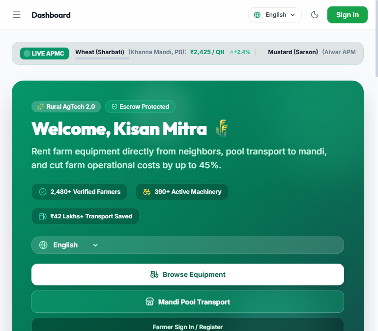
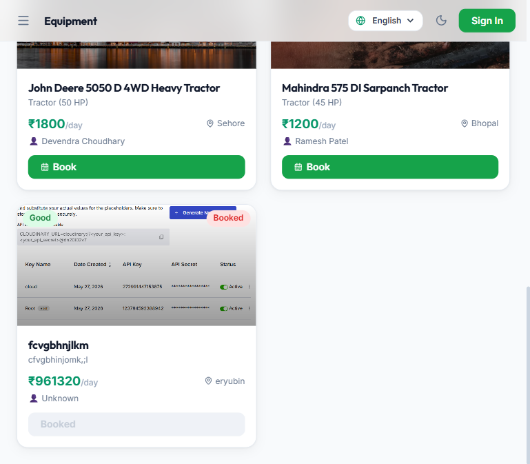
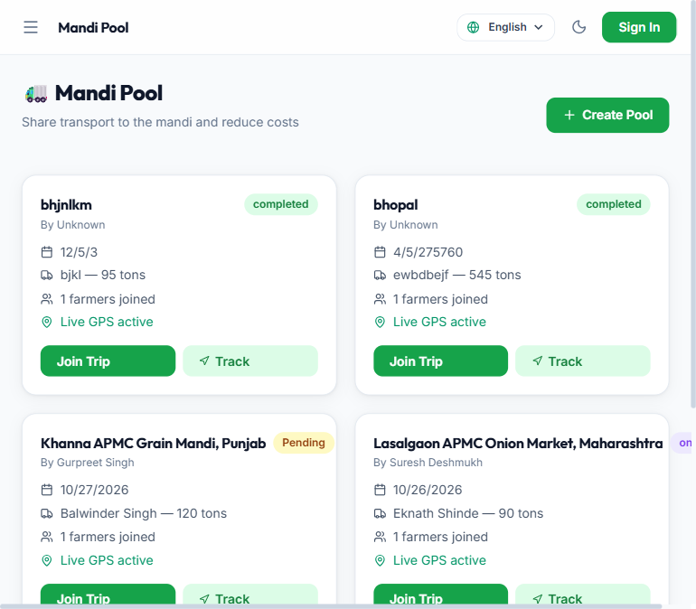
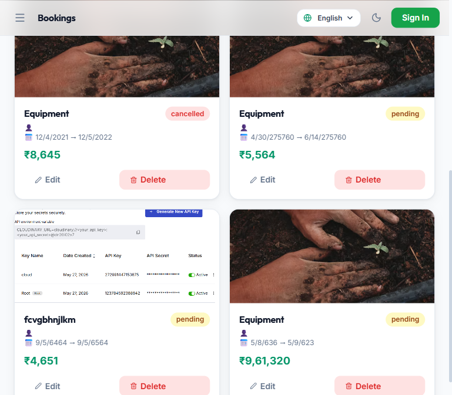
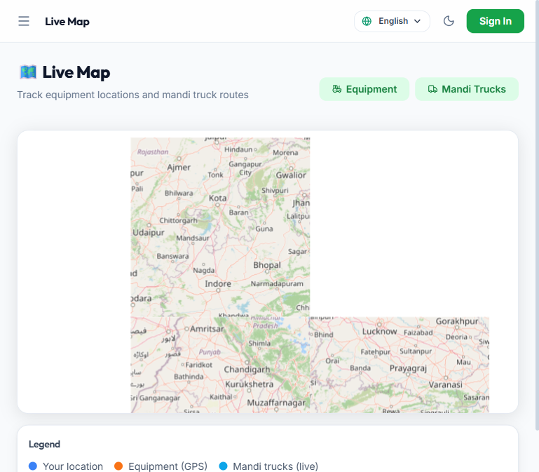
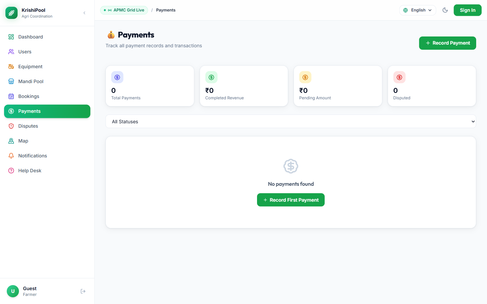
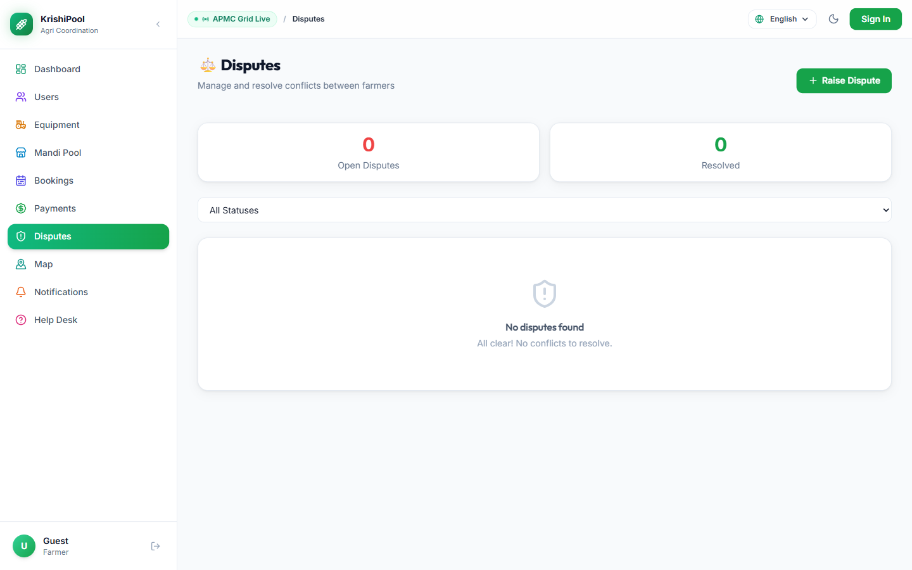
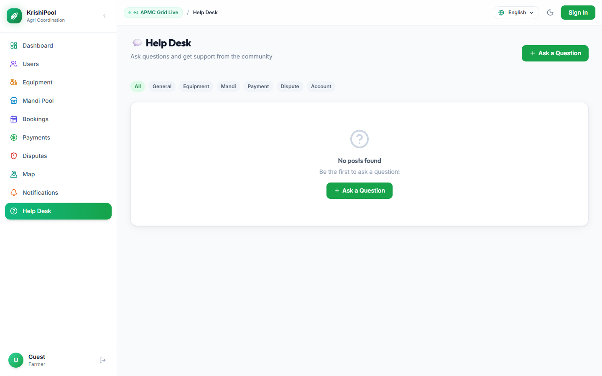
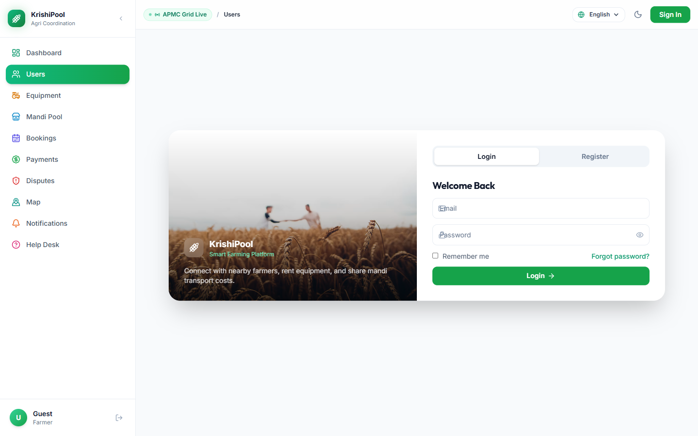

# 🌾 KrishiPool (कृषिपूल) — Rural Agri-Coordination Platform

[](https://nodejs.org/)
[](https://react.dev/)
[](https://expressjs.com/)
[](https://www.mongodb.com/)
[](https://tailwindcss.com/)
[](LICENSE)

> A production-grade **Rural Agri-Coordination SaaS Platform** empowering smallholder farmers through **peer-to-peer machinery rental**, **shared mandi freight pooling**, **transparent escrow settlements**, **community dispute mediation**, and **live GPS tracking**.

---

## 📸 Platform UI Showcase

### 1. Kisan Command Dashboard & Live APMC Price Ticker
*Features real-time APMC Mandi price ticker, interactive transport cost-split calculator, field agro-weather advisory, and live database platform metrics.*



---

### 2. Peer-to-Peer Equipment Marketplace
*Rent tractors, rotavators, drone sprayers, laser levelers, and harvesters directly from nearby farmers with transparent daily pricing and verified owners.*



---

### 3. Mandi Freight Transport Pooling
*Share freight trolleys and trucks to the mandi, reducing logistics costs by up to 45% for smallholder farmers.*



---

### 4. Interactive Booking Engine & Rental Logs
*Track equipment leases, approval stages, delivery schedules, and return handoffs with status tracking.*



---

### 5. Live GPS Machinery & Truck Radar
*Interactive Leaflet map showing active farm machinery and live mandi trucks in nearby villages with direct booking.*



---

### 6. Escrow Payments & Proof-of-Transaction Audit
*Audited transaction tracking with UPI proof-of-payment receipts, QR payments, and status workflows.*



---

### 7. Community Dispute & Mediation Desk
*Fair conflict resolution for fuel adjustments, breakdowns, delay disputes, and panchayat-style mediation.*



---

### 8. Kisan Help Desk & Knowledge Base
*Agricultural advisory, common rental FAQs, community troubleshooting, and platform support.*



---

### 9. Multi-Role Farmer Authentication & Onboarding
*Email & OTP verification, role-based access control (Farmer, Equipment Owner, Driver, Admin).*



---

## 💡 Core Architecture & Features

```
┌─────────────────────────────────────────────────────────────────┐
│                     KrishiPool Client App                       │
│    (React 19 • Vite • Tailwind • Framer Motion • Leaflet)       │
└────────────────────────────────┬────────────────────────────────┘
                                 │ HTTP/JSON + JWT
                                 ▼
┌─────────────────────────────────────────────────────────────────┐
│                    Express 5 Backend Gateway                    │
│   Rate Limiting • Helmet • CORS • Cookie Auth • Trust Proxy     │
└──────────────┬─────────────────────────┬────────────────────────┘
               │                         │
     ┌─────────┴─────────┐     ┌─────────┴─────────┐
     ▼                   ▼     ▼                   ▼
┌───────────┐      ┌───────────────┐         ┌───────────┐
│  MongoDB  │      │  Cloudinary   │         │ SMTP Mail │
│  Cluster  │      │ Media Storage │         │  Service  │
└───────────┘      └───────────────┘         └───────────┘
```

1. **Live Mandi APMC Ticker:** Real-time spot price ticker for Wheat, Mustard, Cotton, Basmati Paddy, Soybean, Chana, Potato, and Onion with 24-hour market trend indicators.
2. **Dynamic Freight Split Calculator:** Interactive sliders calculating per-quintal savings when pooling transport vs solo vehicle booking.
3. **P2P Equipment Marketplace:** Browse, filter, book, and list agricultural implements with machine condition grading (`Good`, `Average`, `Old`).
4. **Mandi Pooling Engine:** Organize shared vehicle journeys to APMC wholesale markets, split fuel/freight among participating farmers based on produce weight.
5. **Interactive GPS Radar:** Real-time geospatial map rendering equipment positions across rural regions with Leaflet & OpenStreetMap.
6. **14 Regional Languages:** English, Hindi, Bengali, Gujarati, Kannada, Malayalam, Marathi, Punjabi, Tamil, Telugu, Urdu, Odia, Assamese, and Nepali.
7. **Trust & Dispute System:** Farmer dispute lodging with evidence attachments and 24-hour admin mediation workflows.

---

## 🛠️ Technology Stack

| Layer | Technologies |
|:---|:---|
| **Frontend** | React 19, Vite, Tailwind CSS, Framer Motion, Lucide Icons, Recharts |
| **State Management** | Redux Toolkit |
| **Mapping & GIS** | React-Leaflet, Leaflet, OpenStreetMap |
| **Backend API** | Node.js (>=18), Express 5, Mongoose, Helmet, Compression, Morgan |
| **Database** | MongoDB Atlas (Multi-collection with cascading hooks) |
| **Authentication** | JWT (Access + Refresh tokens), BcryptJS, OTP Email Verification |
| **Media & Storage** | Cloudinary API, Multer |
| **Email Service** | Nodemailer (Gmail SMTP / Custom SMTP) |
| **DevOps & Containers** | Docker, Nginx, Vercel Serverless |

---

## 🚀 Quickstart & Local Setup

### Prerequisites
- Node.js >= 18.0.0
- MongoDB connection URI (or MongoDB Atlas)
- npm or pnpm

### 1. Backend Setup

```bash
cd Backend

# Configure environment
cp .env.example .env
# Edit .env with your MONGO_URI and JWT_SECRET

# Install dependencies and start server
npm install
npm run dev
```
> Server starts on `http://localhost:5000` (Health check: `http://localhost:5000/health`)

### 2. Frontend Setup

```bash
cd frontend

# Configure environment
cp .env.example .env

# Install dependencies and start Vite dev server
npm install
npm run dev
```
> Client runs on `http://localhost:5176`

---

## 🌐 Cloud Deployment Guides

### Deploying Backend on Vercel or Render
1. Connect your repository to [Render](https://render.com/) or [Vercel](https://vercel.com/).
2. Root directory: `Backend`.
3. Set your environment variables in your deployment dashboard:
   - `MONGO_URI`: Your MongoDB connection string
   - `JWT_SECRET`: Random 64-character secret
   - `CORS_ORIGIN`: Your production frontend URL
4. Build command: `npm install`
5. Start command: `node server.js` (or use `api/index.js` for Vercel serverless).

### Deploying Frontend on Vercel
1. Import the `frontend` folder into [Vercel](https://vercel.com/).
2. Framework Preset: **Vite**.
3. Build Command: `npm run build`.
4. Output Directory: `dist`.
5. Environment Variable: `VITE_API_URL=https://your-backend-domain.com/api`.
6. SPA routing is already preconfigured via `frontend/vercel.json`.

---

## 🔑 REST API Reference

| Method | Endpoint | Access | Description |
|:---|:---|:---|:---|
| `GET` | `/health` | Public | System status and uptime health check |
| `GET` | `/api/admin/overview` | Public | Live platform counts (users, machinery, bookings, mandi pools) |
| `POST` | `/api/auth/register` | Public | Register new farmer account and send OTP |
| `POST` | `/api/auth/login` | Public | User login with password or OTP |
| `POST` | `/api/auth/verify-email` | Public | Verify 6-digit OTP code |
| `POST` | `/api/auth/refresh-token` | Public | Renew expired access token |
| `GET` | `/api/equipment` | Public | List equipment with search and filters |
| `POST` | `/api/equipment` | Authenticated | Create equipment rental listing |
| `GET` | `/api/mandi` | Public | Fetch active mandi transport pools |
| `POST` | `/api/mandi` | Authenticated | Create new mandi transport pool |
| `POST` | `/api/mandi/:id/join` | Authenticated | Join an existing mandi pool with crop weight |
| `GET` | `/api/bookings` | Public/Auth | Fetch farmer booking history |
| `POST` | `/api/bookings` | Authenticated | Create booking for machinery or transport |
| `GET` | `/api/payments` | Authenticated | Fetch payment records and proofs |
| `POST` | `/api/payments` | Authenticated | Upload payment receipt and screenshot |
| `GET` | `/api/disputes` | Authenticated | List disputes and mediation status |
| `POST` | `/api/disputes` | Authenticated | File new dispute |
| `GET` | `/api/admin/stats` | Admin | Aggregate revenue, user, and equipment metrics |

---

## 🧪 Testing & Verification

Run automated test suites across both tiers:

```bash
# Run Backend API unit tests
cd Backend
npm test

# Run Frontend React component unit tests
cd ../frontend
npm test

# Run Frontend linter
npm run lint

# Validate production build bundle
npm run build
```

---

## 📄 License

This project is licensed under the **MIT License**.
